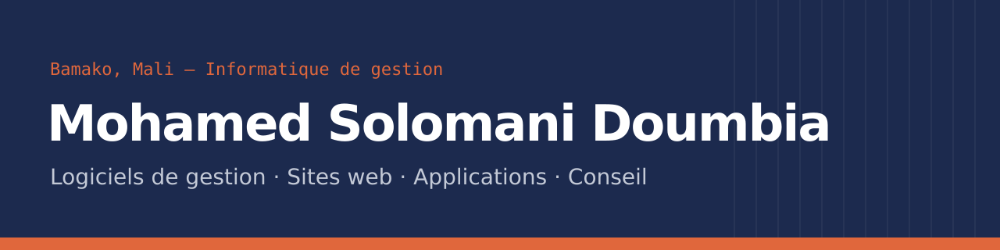

### Bonjour, je suis Mohamed 👋

Développeur en **informatique de gestion** (Master I MIAGE), basé à **Bamako, Mali**.
Je conçois des logiciels de gestion pour les entreprises d'Afrique de l'Ouest : caisse, stocks, ventes, crédit client, facturation. Des outils pensés pour le terrain, qui continuent de fonctionner quand la connexion coupe.

*Business software developer based in Bamako, Mali — [English portfolio](https://viem0s.github.io/en/).*

---

### Projets phares

| Projet | Description | Technologies |
| --- | --- | --- |
| **[Kafora](https://github.com/VIEM0S/KAFORA-ERP)** · [site](https://kafora-erp.netlify.app) · [étude de cas](https://viem0s.github.io/projets/kafora.html) | Logiciel de gestion commerciale multi-entreprises : caisse hors ligne, stocks, crédit client, multi-magasins, factures numérotées selon le SYSCOHADA. Isolation des données par Row Level Security, ~200 tests automatisés. | Next.js · TypeScript · Supabase |
| **CultureCase GS** · [étude de cas](https://viem0s.github.io/projets/culturecase.html) | Gestion de stock et de vente utilisée au quotidien par ABC STUDY : 207 ventes et 184 clients suivis depuis mai 2026, livraisons, segments clients, sauvegardes automatiques, mode hors ligne. | React · Vite · Firebase |
| **[Boutique CultureCase](https://github.com/VIEM0S/Culturecase-site)** · [site](https://viem0s.github.io/Culturecase-site) | Boutique en ligne de coques aux motifs culturels maliens, reliée à CultureCase GS. | JavaScript · Firebase |
| **[Portfolio](https://github.com/VIEM0S/VIEM0S.github.io)** · [site](https://viem0s.github.io/) | Mon site personnel, bilingue français / anglais. | HTML · CSS · JavaScript |

---

### Technologies

---

### Me contacter

Ouvert à un poste en informatique de gestion, ainsi qu'aux missions et projets.
